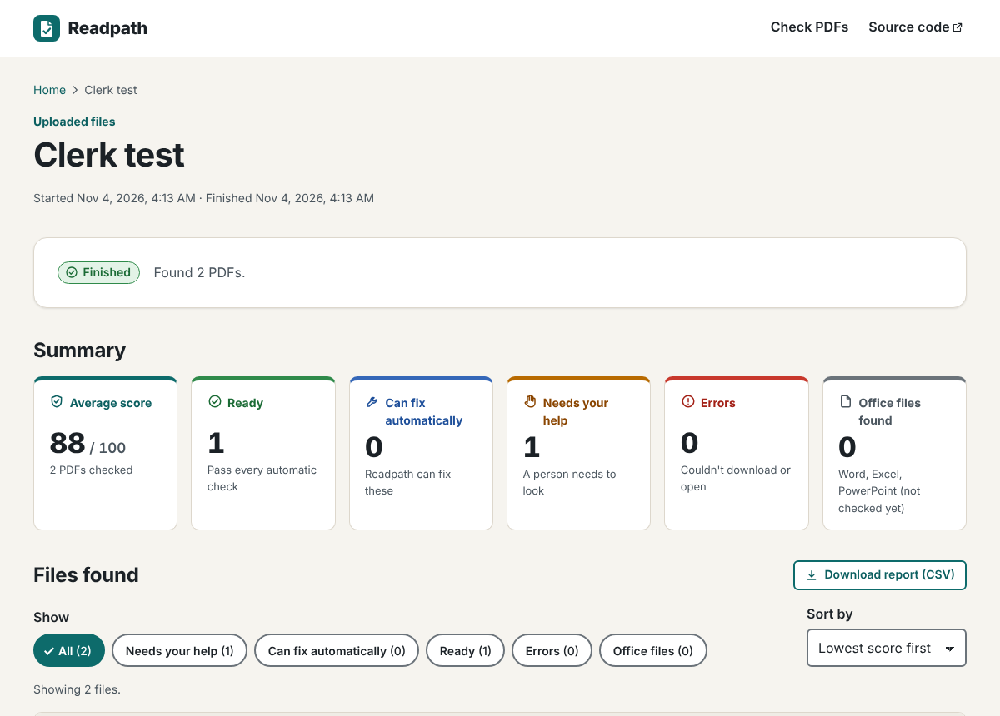
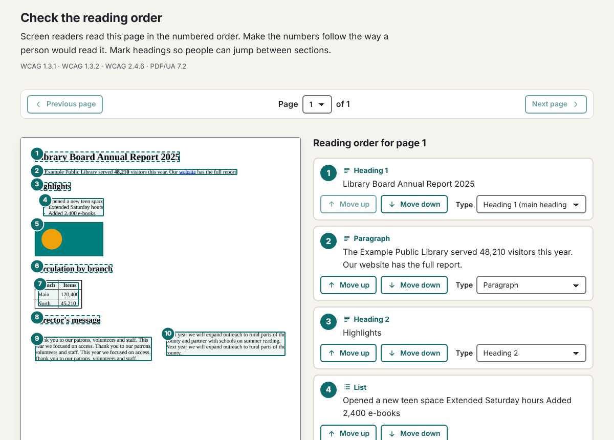
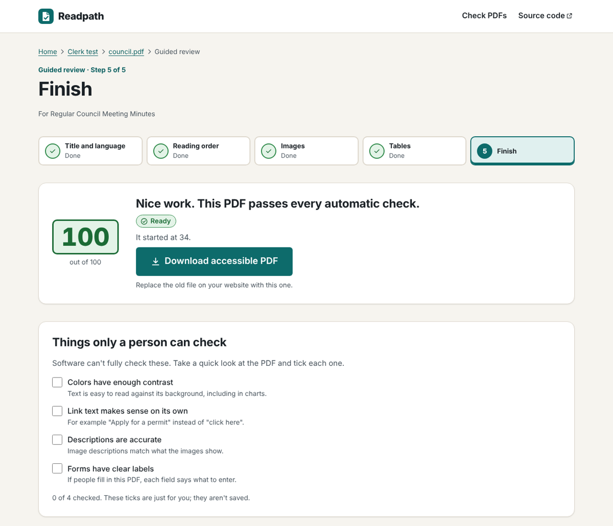
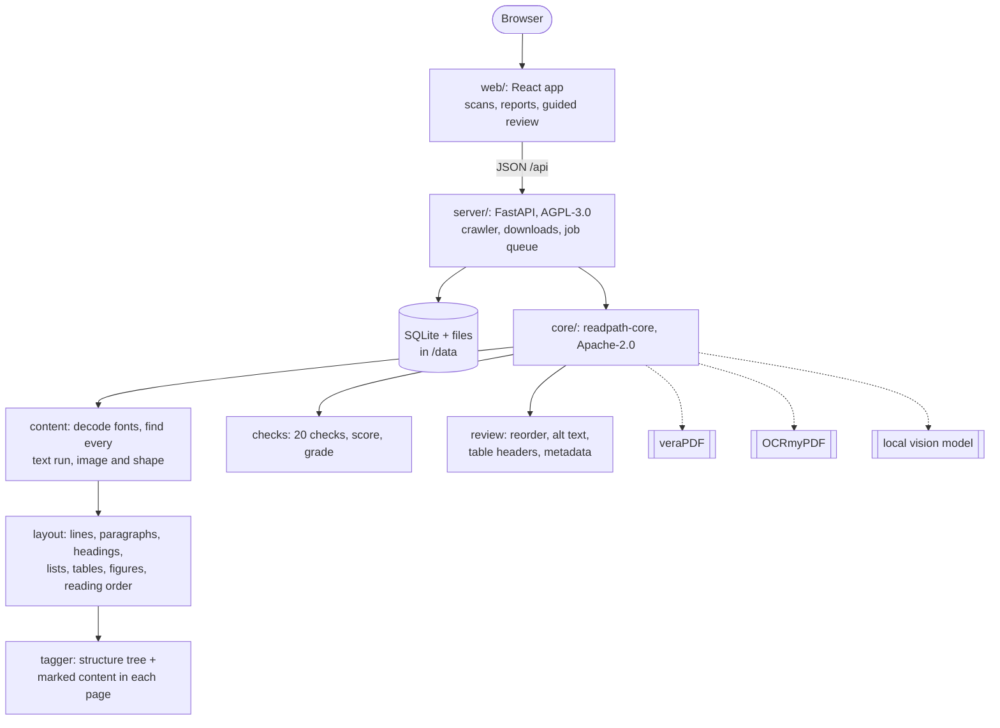

<h1 align="center">Readpath</h1>

<p align="center">
  <strong>Find every PDF on your website, see which ones screen-reader users can't read,<br>
  fix the safe problems automatically, and get walked through the rest.</strong>
</p>

<p align="center">
  <a href="https://github.com/lobojoel2003/Readpath/actions/workflows/ci.yml"></a>
  <a href="https://github.com/lobojoel2003/Readpath/releases/latest"></a>
  <a href="LICENSE"></a>
  <a href="core/LICENSE"></a>
  
  
</p>

Readpath is a free, open-source, self-hosted app for **small governments,
school districts, libraries and nonprofits** that must make the documents they
post meet **WCAG 2.1 AA** under the DOJ's ADA Title II rule, and have no budget
for remediation vendors (manual remediation is quoted at €50–150 per page).

| Who | Deadline to meet WCAG 2.1 AA |
|---|---|
| State and local governments serving 50,000 people or more | **April 26, 2027** |
| Smaller governments and special districts | **April 26, 2028** |

| Every PDF on the site, scored | Guided review: reading order | Done: download the fixed file |
|---|---|---|
|  |  |  |

## Contents

- [What it does](#what-it-does)
- [Quick start](#quick-start)
- [Using Readpath](#using-readpath)
- [What Readpath checks](#what-readpath-checks)
- [Configuration](#configuration)
- [Command line and Python library](#command-line-and-python-library)
- [HTTP API](#http-api)
- [How it works](#how-it-works)
- [Limitations](#limitations)
- [Development](#development)
- [Licensing](#licensing)
- [Related work](#related-work)

## What it does

1. **Crawl** your website, or upload PDFs, and list every document it links to,
   including CMS links with no `.pdf` in the address (CivicPlus `DocumentCenter`,
   `AgendaCenter` and similar). Word, Excel and PowerPoint files are listed too.
2. **Score** each PDF from 0 to 100 against [20 checks](#what-readpath-checks)
   mapped to WCAG 2.1 and PDF/UA-1 (ISO 14289-1), explained in plain language.
3. **Fix automatically** what is safe to fix. Nothing moves on the page; the
   tests render every page before and after and compare the pixels.
   - **Adds tags to untagged PDFs**: headings with levels, paragraphs, bulleted
     and numbered lists, tables (with or without ruling lines) with header
     cells, images and vector charts, links and form fields. Page headers,
     footers and page numbers are marked as decoration. The reading order comes
     from the layout, including multi-column pages.
   - Sets the document language (detected from the text) and a title (from the
     first heading), and shows the title instead of the file name.
   - Describes and tags links, tags comments and form fields, and fixes the tab order.
   - Adds bookmarks to long documents from their headings.
   - Embeds exact-width substitutes for unembedded Helvetica, Times and Courier.
   - Removes security settings that lock screen readers out.
   - Runs text recognition (OCR) on scanned pages.
4. **Guided review** for what software can't decide alone, next to the page image:
   - **Title and language**
   - **Reading order**: numbered boxes on the page; move blocks up and down,
     set heading levels, or take headers and footers out of the reading order
   - **Images**: write a description or mark the image decorative. A local
     vision model can draft descriptions; a person always confirms them
   - **Tables**: tick "first row has headings" and "first column has headings"
5. **Download** the accessible PDF (originals are always kept), export a CSV
   report, and get a second opinion from [veraPDF](https://verapdf.org), the
   reference PDF/UA validator.

## Quick start

### Docker (recommended)

You need [Docker](https://docs.docker.com/get-docker/). The published image
includes veraPDF, OCR and the substitute fonts.

```bash
docker run -d --name readpath -p 8000:8000 -v readpath-data:/data ghcr.io/lobojoel2003/readpath:latest
```

Then open **http://localhost:8000**.

### Docker Compose (build from source)

```bash
git clone https://github.com/lobojoel2003/Readpath.git
```

```bash
cd Readpath && docker compose up -d
```

To have a local vision model draft image descriptions (nothing leaves your server):

```bash
docker compose -f docker-compose.yml -f docker-compose.vision.yml up -d
```

```bash
docker compose exec ollama ollama pull qwen2.5vl:3b
```

> **On a public server**, set `READPATH_PASSWORD` (see [Configuration](#configuration))
> and put Readpath behind HTTPS. See [SECURITY.md](SECURITY.md).

### Without Docker

Python 3.11+ and Node 20.19+:

```bash
pip install ./core ./server && (cd web && npm ci && npm run build)
```

```bash
readpath-server --host 0.0.0.0 --port 8000
```

Install [veraPDF](https://verapdf.org), [OCRmyPDF](https://ocrmypdf.readthedocs.io)
and the Liberation fonts for the optional features.

## Using Readpath

1. **Start a scan.** Enter your website's address (for example `exampletown.gov`)
   or upload PDFs. Readpath visits up to 200 pages by default.
2. **Read the summary.** Each PDF gets a score and one of three results:

   | Result | Meaning | What to do |
   |---|---|---|
   | **Ready** | Passes every automatic check | Spot-check it, then you're done |
   | **Can fix automatically** | Has problems Readpath can fix by itself | Click **Fix all automatically** |
   | **Needs your help** | The rest needs a person | Open the **guided review** |

3. **Fix automatically.** Readpath keeps the original and works on a copy.
   **Undo all changes** restores the original at any time.
4. **Review.** Five short steps: title and language, reading order, images,
   tables, finish. Each shows the page and explains what to look for.
5. **Download** the accessible PDF and replace the old file on your website.
   **Download report (CSV)** gives you a record of every file and its status.

## What Readpath checks

| Check | WCAG 2.1 | PDF/UA-1 | How it gets fixed |
|---|---|---|---|
| Text can be read (not just a picture) | 1.1.1, 1.4.5 | 7.1 | Automatically (OCR) |
| Document has tags | 1.3.1, 4.1.2 | 7.1 | Automatically |
| All content is tagged | 1.3.1 | 7.1 | Automatically (re-tag) or in the source file |
| Document has a title | 2.4.2 | 7.1 | Automatically, then confirmed in the review |
| Title is shown instead of the file name | 2.4.2 | 7.1 | Automatically |
| Document language is set | 3.1.1 | 7.2 | Automatically |
| Images have descriptions | 1.1.1 | 7.3 | Guided review |
| Tables have header cells | 1.3.1 | 7.5 | Guessed automatically, confirmed in the review |
| Headings organize the document | 1.3.1, 2.4.6 | 7.4 | Automatically, adjusted in the review |
| Reading order makes sense | 1.3.2, 2.4.3 | 7.2 | Guided review |
| Text uses real characters | 1.3.1, 4.1.2 | 7.21.7 | Source file or OCR |
| Fonts are embedded | | 7.21.4.1 | Automatically for standard fonts |
| Links are tagged and described | 2.4.4, 4.1.2 | 7.18.1, 7.18.5 | Automatically |
| Form fields have labels | 1.3.1, 3.3.2, 4.1.2 | 7.18.1, 7.18.4 | In a PDF editor |
| Comments and form fields are tagged | 4.1.2 | 7.18.1 | Automatically |
| Tab key follows the reading order | 2.4.3 | 7.18.3 | Automatically |
| Long document has bookmarks | 2.4.5 | | Automatically |
| Security settings allow screen readers | 4.1.2 | 7.16 | Automatically |
| Tags use standard names | 4.1.2 | 7.1 | In a PDF editor |
| Marked as PDF/UA | | 5 | Added when the review is finished |

The score weighs each check by severity (critical, serious, moderate, minor),
gives partial credit when some images or tables are done, and counts warnings
as half. Things software can't judge, such as color contrast and whether
descriptions are accurate, are listed at the end of the review for a person to look at.

## Configuration

Set these as environment variables (for Docker, in `docker-compose.yml` or with `-e`).

| Variable | Default | Meaning |
|---|---|---|
| `READPATH_PASSWORD` | none | Require a shared password (HTTP Basic auth, any user name) |
| `READPATH_DEFAULT_LANG` | `en-US` | Language used when it can't be detected |
| `READPATH_WORKERS` | `2` | Documents checked or fixed at the same time |
| `READPATH_VERAPDF_ON_SCAN` | `false` | Run veraPDF on every crawled PDF (slower). It always runs on **Run again** and when a review is finished |
| `READPATH_VISION_URL` | none | Vision model server for draft alt text, e.g. `http://ollama:11434` |
| `READPATH_VISION_MODEL` | `qwen2.5vl:3b` | Vision model name |
| `READPATH_VISION_API` | `ollama` | `ollama`, or `openai` for llama.cpp, LM Studio, vLLM and other OpenAI-compatible servers |
| `READPATH_MAX_UPLOAD_MB` | `100` | Largest upload |
| `READPATH_MAX_PAGES_LIMIT` | `5000` | Most web pages one scan may visit |
| `READPATH_ALLOW_PRIVATE_HOSTS` | `false` | Allow scanning intranet sites. Off by default so a public server can't be used to reach internal addresses |
| `READPATH_DATA` | `/data` in Docker, `./data` otherwise | Database and files |
| `READPATH_VERAPDF`, `READPATH_OCRMYPDF`, `READPATH_FONT_DIR` | found on `PATH` / system font folders | Locations of the optional tools |

## Command line and Python library

The PDF engine is a separate library, **readpath-core** (Apache-2.0), so
agencies and vendors can build it into their own systems. Install it from a
[release](https://github.com/lobojoel2003/Readpath/releases) wheel or from source:

```bash
pip install ./core
```

```bash
readpath check minutes.pdf
```

```bash
readpath fix minutes.pdf -o minutes-accessible.pdf
```

`readpath check --json --verapdf *.pdf` prints machine-readable results, and
the exit code is non-zero when a file isn't ready, which is handy in publishing
pipelines.

```python
from readpath_core import check_file, autofix_file

report = check_file("minutes.pdf")
print(report.score, report.grade)
autofix_file("minutes.pdf", "minutes-accessible.pdf")
```

The guided-review edits (reading order, alt text, table headers, metadata) are
in `readpath_core.review.Review`. See [core/README.md](core/README.md).

## HTTP API

Everything the web app does goes through a JSON API under `/api`, documented in
[docs/api.md](docs/api.md). Interactive docs are served at `/api/docs`.

```bash
curl -F files=@minutes.pdf http://localhost:8000/api/uploads
```

## How it works



The tagger rewrites each page's content stream so every piece of content is
either tagged (`/P <</MCID 3>> BDC … EMC`) or marked as decoration
(`/Artifact`). It always wraps at the deepest safe level, so tags nest correctly
with text objects, graphics state and any existing marked content. CI checks
the output with veraPDF on every change: automatically tagged files pass
PDF/UA-1 except for what needs a person (image descriptions), and reviewed
files pass completely.

```
core/       readpath-core: the PDF engine and `readpath` CLI      (Apache-2.0)
server/     readpath-server: crawler, jobs, storage, HTTP API      (AGPL-3.0)
web/        React + TypeScript web app                             (AGPL-3.0)
docker/     veraPDF bundle (Maven) used by the Dockerfile
docs/       HTTP API reference and screenshots
scripts/    release helpers and the container smoke test
```

## Limitations

No software can certify WCAG conformance by itself. A person should still
check that descriptions are accurate, link text makes sense, colors have enough
contrast, and the reading order matches the meaning.

- **Fonts that aren't embedded**, other than Helvetica/Arial, Times and
  Courier, need the source file (re-export with "embed fonts" on).
- **Vector charts** are detected when their shapes form a clear cluster;
  check the reading-order step for anything missed.
- **Complex layouts** (forms, nested tables, magazine spreads) may need more
  reading-order fixes in the review.
- **Form fields without labels** are flagged but must be labelled in a PDF editor.
- **Office files** (Word, Excel, PowerPoint) are listed but not checked yet.
- **Already-tagged files** keep their tags; Readpath re-tags only when most of
  the content is untagged.

## Development

See [CONTRIBUTING.md](CONTRIBUTING.md) for setup, tests and the release
process. In short:

```bash
pip install -e "./core[test]" -e "./server[test]"
```

```bash
(cd core && pytest) && (cd server && pytest) && (cd web && npm ci && npm run build)
```

CI ([.github/workflows/ci.yml](.github/workflows/ci.yml)) runs on every push:
lint, engine tests on Python 3.11–3.13, server and crawler tests, veraPDF
PDF/UA-1 conformance of Readpath's output, the web build, and a Docker image
smoke test (upload, automatic fixes, OCR, font embedding and veraPDF inside
the container). Pushing a `v*.*.*` tag runs the
[release workflow](.github/workflows/release.yml), which publishes the Docker
image, Python packages and web bundle. Changes are listed in
[CHANGELOG.md](CHANGELOG.md).

## Licensing

- **The app** (`web/`, `server/`, Docker files and scripts):
  **GNU AGPL-3.0-or-later** ([LICENSE](LICENSE)). Anyone who offers a modified
  copy as a hosted service must share their changes, so remediation vendors
  can't resell a closed hosted copy.
- **The engine** (`core/`, `readpath-core`): **Apache-2.0**
  ([core/LICENSE](core/LICENSE)), so agencies and vendors can embed it. This is
  the same license as pdf-a11y.

Readpath runs [veraPDF](https://verapdf.org) (GPL-3.0+/MPL-2.0) and
[OCRmyPDF](https://ocrmypdf.readthedocs.io) (MPL-2.0) as separate programs and
embeds the [Liberation fonts](https://github.com/liberationfonts) (SIL OFL 1.1)
when it substitutes standard fonts. See [core/NOTICE](core/NOTICE).

## Related work

- [pdf-a11y](https://pypi.org/project/pdf-a11y/) (Apache-2.0): a command-line
  remediation pipeline using Python, Java and veraPDF.
- [veraPDF](https://verapdf.org): the open-source PDF/UA and PDF/A validator.
- The leading commercial remediation tools (Acrobat Pro, CommonLook, Equidox,
  PREP and others) are not open source
  ([Continual Engine's 2026 roundup](https://www.continualengine.com/blog/best-pdf-remediation-tools/)).
- Deadlines: [Siteimprove on ADA Title II document accessibility](https://www.siteimprove.com/blog/ada-title-ii-document-accessibility/).
